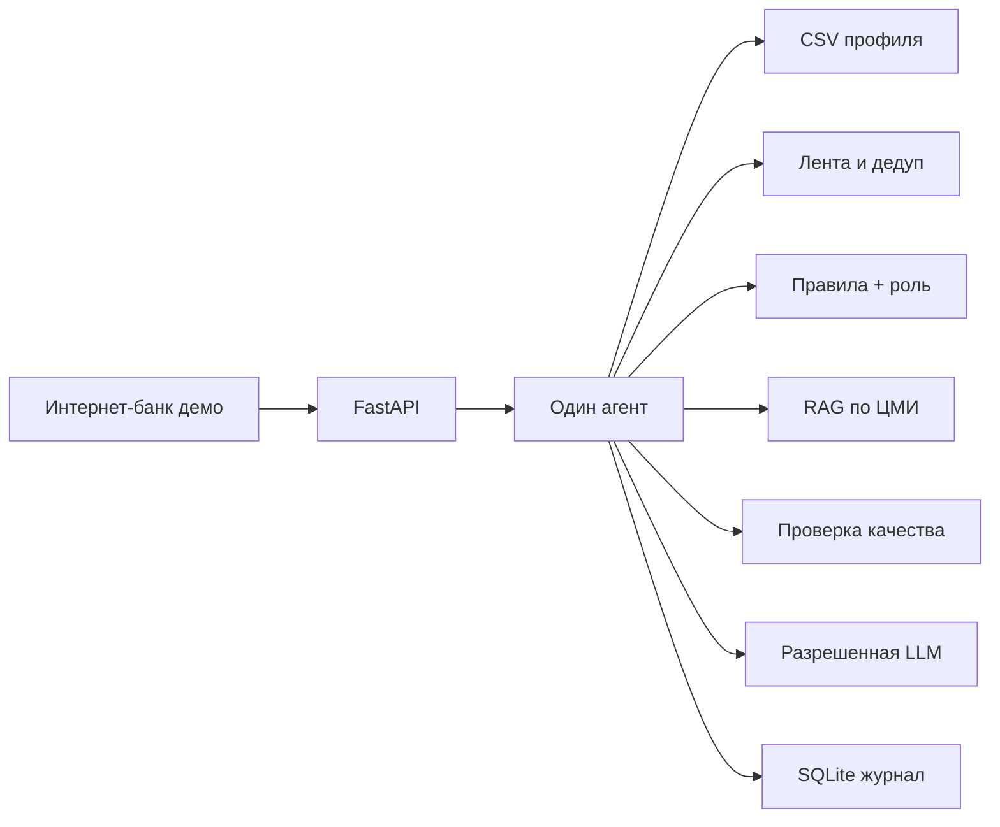

# Альфа-Бизнес · Новостная аналитика

Сервис для руководителя крупного бизнеса: из интернет-банка открыть постоянную точку входа «Инсайты», увидеть события, которые относятся к выбранной компании и роли, и разобрать влияние с фактами, позицией банка и выводами AI.

Крупный бизнес в кейсе — компании с выручкой **свыше 15 млрд ₽**.

## Что можно проверить сразу

1. Войдите пользователем компании `U_200890` / генеральный директор. Это обезличенный оптовик металлов из оригинальной выгрузки, выручка около 59,6 млрд ₽.
2. На главной интернет-банка плитка «Новостная аналитика» всегда видна. Пункт «Инсайты» в шапке тоже всегда доступен.
3. В сводке директора первая новость — про сталь. Спортивный сюжет не входит. Дубль про сталь снят.
4. У этой компании в выгрузке нет кредитной линии, поэтому казначей той же компании поднимает сюжет про группу, а не ставку. Ставка 14% становится первой у казначея розничной компании `U_1595`: там кредитная линия в датасете есть.
5. Откройте новость про ставку у `U_1595`: блок «Как это оценивает банк» берет выдержку из PDF ЦМИ. Выводы AI отделены. Ниже — нативное предложение продукта, не аналитика ЦМИ.
6. Вопрос «Кто бенефициар компании?» не восстанавливает ФИО: только обезличенный SYNTHETIC_F и признак ключевого собственника.
7. `U_1595` поднимает розницу, а не сталь. `U_67` с выручкой около 0,1 млн ₽ в рабочий контур крупного бизнеса не входит. Пустые продукты и платежи не заполняются догадкой.
8. В ленте нажмите «Проверить новость», введите новый заголовок, текст и дату. Сервис классифицирует материал, ищет банковский контекст и строит разбор для выбранной компании. Это предварительный разбор: новость не попадает в общую ленту, ее сведения остаются непроверенными.
9. В обычном разборе оцените полезность. Повторная оценка того же пользователя заменяет предыдущую; счетчик и доля положительных оценок доступны в `/api/metrics`.
10. В карточке аналитики банка откройте ссылку на конкретную страницу оригинального PDF. Для старых исследований указан исторический характер; результат OCR имеет отдельную оговорку о возможных ошибках.

## Архитектура



Один агент проходит шаги: задача → профиль → роль → лента → дедуп → ранжирование → документы → черновик → проверка → правка → сохранение. Между шагами JSON. Журнал инструментов пишет имя шага, компанию, пользователя и статус. Ключ модели в журнал не попадает.

В ответе есть `plan`, `context`, `trace` и результат проверки `quality`. Если поиск по темам не дал банковских материалов, агент действительно повторяет его по тексту выдержек. Если проверка не устранила все проблемы, `quality.passed` остается `false`, а вызов модели пропускается. Ключ кеша учитывает содержание новости, профиль, роль, корпус документов и режим модели.

Релевантность — сумма весов правил. Роль дает надбавку своим темам и снижает вес чужих. Ответ не выбирается из таблицы «компания → готовый текст».

## Данные

Профили читаются из оригинальных файлов приложения 1. PDF приложения 2 лежат в `backend/data/bank_pdfs`. Девять файлов содержат 64 страницы сканов; рядом сохранен распознанный текст `*.pdf.ocr.json`, привязанный к SHA256 оригинала. При загрузке `pypdf` извлекает текстовый слой либо использует проверенный по хешу OCR-файл и формирует фрагменты с номерами страниц. Пустые и поврежденные документы не заменяются пересказом заголовка. Новостные сюжеты в `news.json` остаются учебными: в кейсе не было ленты.

| Файл | Назначение |
| --- | --- |
| `backend/data/df_Uid_data_hack.csv` | Юридические лица, оригинальная выгрузка |
| `backend/data/df_Fid_Uid_link_hack.csv` | Связи физлиц и компаний |
| `backend/data/df_Uid_payment_hack.csv` | Платежный граф |
| `backend/data/bank_pdfs/` | Исследования ЦМИ из приложения 2 |
| `backend/data/company_labels.json` | Необязательные подписи. Пустой объект оставляет имя равным SYNTHETIC_U |
| `backend/data/users.json` | Тестовые роли на реальных идентификаторах |
| `backend/data/news.json` | Учебные сюжеты |
| `backend/data/documents.json` | Каталог названий и тем; его тексты не используются вместо PDF |

Самопереводы не считаются контрагентами. Доли платежей считаются отдельно от входящего и исходящего потока и не называются долями выручки или затрат. Диапазоны численности сохраняются как диапазоны; точное число сотрудников не восстанавливается. Доля рынка неизвестна: в данных нет сопоставимого объема рынка. ОКВЭД сохраняет конкретный вид деятельности — например, одежду нельзя автоматически считать продовольствием.

Повторный импорт текстовых фрагментов (необязательный экспорт для диагностики):

```powershell
$env:PYTHONPATH = "backend"
python -m app.sources.bank_pdf --output backend/runtime/bank_documents.json
```

Для новых сканов на Windows с установленным русским пакетом распознавания:

```powershell
& "$env:SystemRoot\System32\WindowsPowerShell\v1.0\powershell.exe" -NoProfile -File scripts/ocr_bank.ps1
```

Для поставляемого корпуса OCR уже выполнен: Windows и OCR-движок не нужны при обычном запуске, в том числе в Docker. При изменении PDF старый OCR отклоняется по хешу. После изменения файлов перезапустите приложение, чтобы обновить кеш данных. OCR не является редакционной проверкой: числа и таблицы сверяются с PDF. Исследование по стали от 15 апреля 2021 года является историческим, а не текущим прогнозом.

В рабочий контур попадают компании с выручкой выше 15 млрд ₽. В этой выгрузке их 115 из 85 525. Отрасль для правил берется из ОКВЭД: оптовая торговля металлами сопоставляется со сюжетом про сталь, розница — с оборотом, перевозки — с топливом.

## Запуск на Windows

Нужен Python 3.12. Версия зафиксирована в `.python-version`.

```powershell
python -m venv .venv
.\.venv\Scripts\Activate.ps1
pip install -r requirements.lock
python -m uvicorn app.main:app --app-dir backend --host 127.0.0.1 --port 8000
```

Откройте http://127.0.0.1:8000

Проверки:

```powershell
python -m pytest backend/tests
node --test frontend/app.test.cjs
```

OpenAPI: http://127.0.0.1:8000/docs и http://127.0.0.1:8000/openapi.json

## Docker

```powershell
docker compose up --build
```

Сервис: http://127.0.0.1:8000

Образ устанавливает зависимости из `requirements.lock`. SQLite сохраняется в томе `insights-data`. Docker Compose читает настройки модели и лент из `.env` или окружения; пример имен переменных находится в `.env.example`. При запуске Python напрямую задайте переменные в оболочке: файл `.env` сам по себе приложением не загружается.

## Модель

Разрешены только имена из задания. Чужое имя блокируется.

```
LLM_BASE_URL=адрес_от_организаторов
LLM_API_KEY=ключ
LLM_MODEL=Gemma 4 26B A4B
LLM_MAX_CALLS=8
```

Модель может только переписать уже собранный разбор. Новые числа, формулировки гарантированного эффекта и необоснованное упоминание банка отсекаются. Это ограниченная проверка, а не полная фактологическая верификация. Без переменных расход равен нулю. `LLM_MAX_CALLS` ограничивает число запросов в одном процессе, но не гарантирует денежный лимит 500 ₽: дневной лимит токенов и расходов должен задаваться на стороне провайдера организаторов.

Живая RSS/Atom-лента необязательна:

```
NEWS_FEED_URLS=https://example.com/feed.xml
```

## Безопасность прототипа

- Если передан `user_id`, проверяется его принадлежность компании; несовпадение дает 403. Это проверка связи в демо, а не аутентификация: без `user_id` API допускает просмотр обезличенных данных, и тестовые роли выбираются свободно.
- Секреты только в окружении, `.env` не коммитится.
- Журнал инструментов без тел профиля и без ключа.
- Демо-вход не является промышленной аутентификацией.
- Перед промышленным подключением нужен банковский SSO: сервер получает пользователя из проверенной сессии, а доступные компании — из прав пользователя; клиентский `user_id` не считается доказательством личности. `/api/users`, `/api/companies` и `/api/metrics` должны быть закрыты соответствующими правами. SQLite с профилями разборов, вопросами и отзывами требует ограничения доступа, срока хранения и резервирования.
- Новости и PDF — данные, не инструкции для инструментов. Агент не исполняет код и не совершает банковских операций. Произвольная ссылка в форме новости только отображается и не загружается сервером. PDF-путь ограничен каталогом исследований; CSV и OCR-файлы через него не выдаются.

## Мониторинг

`GET /api/metrics` отдает число прогонов, разборов, вопросов и вызовов инструментов, долю разборов с банковскими источниками, долю правок, число неуспешных проверок и оценки полезности. При пустой выборке доля возвращается как `null`, а не как нулевое качество. Статистика по разборам учитывает сохраненные версии кеша, поэтому это не число уникальных просмотров.

Предлагаемые регулярные метрики:

- персонализация: доля сводок, где первая карточка меняется при смене компании или роли;
- покрытие банка: доля разборов с `is_bank_research`;
- качество: доля правок quality gate;
- AI: вызовы модели, отказы allowlist, отклоненные формулировки;
- обратная связь: уточняющие вопросы и оценка эксперта на демо.

Процесс сопровождения: еженедельно эксперт проверяет выборку разборов с низкими оценками, без банковских источников и с правками качества; ошибки классификации и интерпретации добавляются в регрессионные сценарии. Перед выпуском сравниваются первые карточки по компаниям и ролям и проверяются новые материалы, отсутствующие в `news.json`. Новые отрасли расширяют классификатор и правила в `services/impact.py`; новый источник подключается через адаптер ленты. Для больших объемов загрузку и индексирование нужно вынести в фоновые задания, JSON/SQLite заменить хранилищем с разграничением доступа, а поиск — индексом по фрагментам и метаданным.

## Сдача

Репозиторий: https://github.com/aewnull23/business-insights

Для приватного репозитория жюри: `alfa-hack-2026`.

Перед сдачей сохраните итоговые изменения в Git и укажите полученный `git rev-parse HEAD` в материалах. Наличие локальных изменений не означает, что они опубликованы или что доступ жюри уже настроен. Внешнее размещение и ключ LLM настраиваются отдельно.
