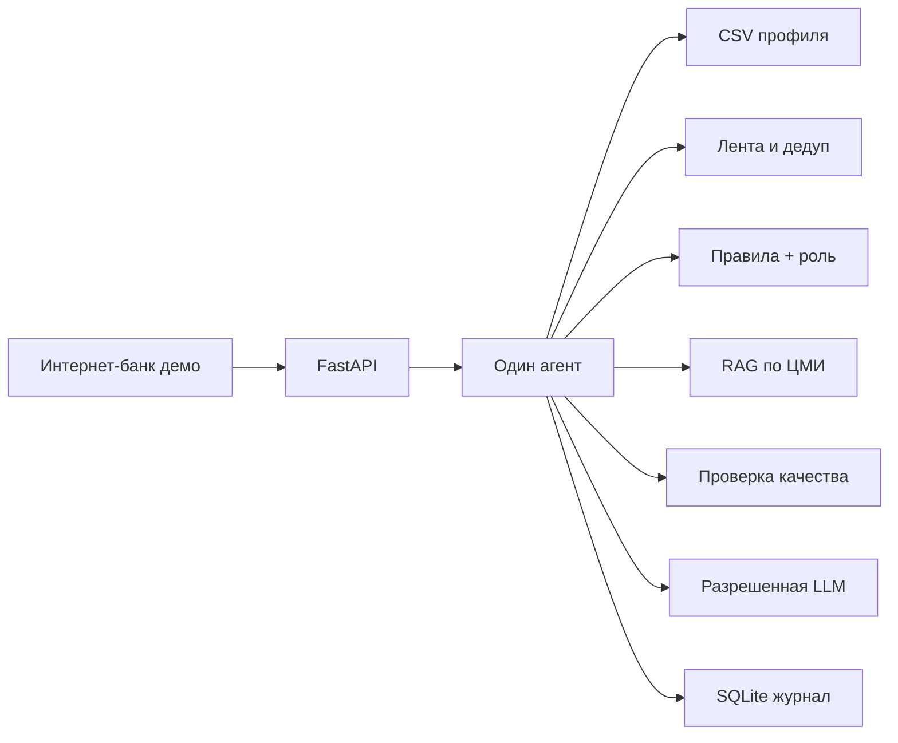

# Альфа-Бизнес · Новостная аналитика

Сервис для руководителя крупного бизнеса: из интернет-банка открыть постоянную точку входа «Инсайты», увидеть события, которые относятся к выбранной компании и роли, и разобрать влияние с фактами, позицией банка и выводами AI.

Крупный бизнес в кейсе — компании с выручкой **свыше 15 млрд ₽**.

## Что можно проверить сразу

1. Войдите пользователем компании `U_200890` / генеральный директор. Это обезличенный оптовик металлов из оригинальной выгрузки, выручка около 59,6 млрд ₽.
2. На главной интернет-банка плитка «Новостная аналитика» всегда видна. Пункт «Инсайты» в шапке тоже всегда доступен.
3. В сводке директора первая новость — про сталь. Спортивный сюжет не входит. Дубль про сталь снят.
4. У этой компании в выгрузке нет кредитной линии, поэтому казначей той же компании поднимает сюжет про группу, а не ставку. Ставка 14% становится первой у казначея розничной компании `U_1595`: там кредитная линия в датасете есть.
5. Откройте новость про ставку у `U_1595`: блок «Как это оценивает банк» берет выдержку из PDF ЦМИ. Выводы AI отделены. Ниже — нативное предложение продукта, не аналитика ЦМИ.
6. Вопрос «Кто бенефициар компании?» не восстанавливает ФИО: только обезличенный SYNTHETIC_F и признак ключевого собственника.
7. `U_1595` поднимает розницу, а не сталь. `U_67` с выручкой около 0,1 млн ₽ в рабочий контур крупного бизнеса не входит. Пустые продукты и платежи не заполняются догадкой.

## Архитектура



Один агент проходит шаги: задача → профиль → роль → лента → дедуп → ранжирование → документы → черновик → проверка → правка → сохранение. Между шагами JSON. Журнал инструментов пишет имя шага, компанию, пользователя и статус. Ключ модели в журнал не попадает.

Релевантность — сумма весов правил. Роль дает надбавку своим темам и снижает вес чужих. Ответ не выбирается из таблицы «компания → готовый текст».

## Данные

Профили читаются из оригинальных файлов приложения 1. PDF приложения 2 лежат в `backend/data/bank_pdfs`, в поиск попадает выдержка, а не пересказ по заголовку. Новостные сюжеты в `news.json` остаются учебными: в кейсе не было ленты.

| Файл | Назначение |
| --- | --- |
| `backend/data/df_Uid_data_hack.csv` | Юридические лица, оригинальная выгрузка |
| `backend/data/df_Fid_Uid_link_hack.csv` | Связи физлиц и компаний |
| `backend/data/df_Uid_payment_hack.csv` | Платежный граф |
| `backend/data/bank_pdfs/` | Исследования ЦМИ из приложения 2 |
| `backend/data/company_labels.json` | Необязательные подписи. Пустой объект оставляет имя равным SYNTHETIC_U |
| `backend/data/users.json` | Тестовые роли на реальных идентификаторах |
| `backend/data/news.json` | Учебные сюжеты |
| `backend/data/documents.json` | Выдержки PDF для поиска |

В рабочий контур попадают компании с выручкой выше 15 млрд ₽. В этой выгрузке их 115 из 85 525. Отрасль для правил берется из ОКВЭД: оптовая торговля металлами сопоставляется со сюжетом про сталь, розница — с оборотом, перевозки — с топливом.

## Запуск на Windows

Нужен Python 3.12. Версия зафиксирована в `.python-version`.

```powershell
python -m venv .venv
.\.venv\Scripts\Activate.ps1
pip install -r requirements.lock
python -m uvicorn app.main:app --app-dir backend --host 127.0.0.1 --port 8000
```

Откройте http://127.0.0.1:8000

Проверки:

```powershell
python -m pytest backend/tests
```

OpenAPI: http://127.0.0.1:8000/docs и http://127.0.0.1:8000/openapi.json

## Docker

```powershell
docker compose up --build
```

Сервис: http://127.0.0.1:8000

## Модель

Разрешены только имена из задания. Чужое имя блокируется.

```
LLM_BASE_URL=адрес_от_организаторов
LLM_API_KEY=ключ
LLM_MODEL=Gemma 4 26B A4B
LLM_MAX_CALLS=8
```

Модель может только переписать уже собранный разбор. Новые числа и необоснованное упоминание банка отсекаются. Без переменных расход равен нулю.

Живая лента необязательна:

```
NEWS_FEED_URLS=https://example.com/feed.xml
```

## Безопасность прототипа

- Пользователь видит только свою компанию: чужой `user_id` дает 403.
- Секреты только в окружении, `.env` не коммитится.
- Журнал инструментов без тел профиля и без ключа.
- Демо-вход не является промышленной аутентификацией.

## Мониторинг

`GET /api/metrics` отдает число прогонов, разборов, вопросов и вызовов инструментов.

Предлагаемые регулярные метрики:

- персонализация: доля сводок, где первая карточка меняется при смене компании или роли;
- покрытие банка: доля разборов с `is_bank_research`;
- качество: доля правок quality gate;
- AI: вызовы модели, отказы allowlist, отклоненные формулировки;
- обратная связь: уточняющие вопросы и оценка эксперта на демо.

## Сдача

Репозиторий: https://github.com/aewnull23/business-insights

Для приватного репозитория жюри: `alfa-hack-2026`.
